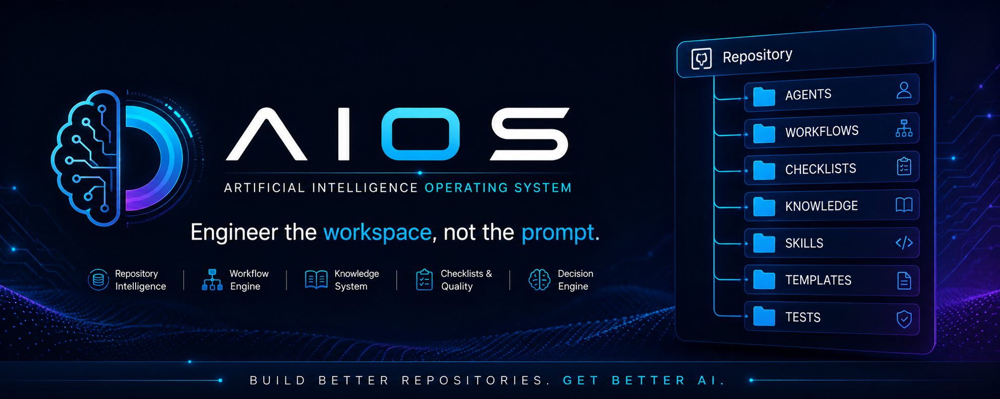
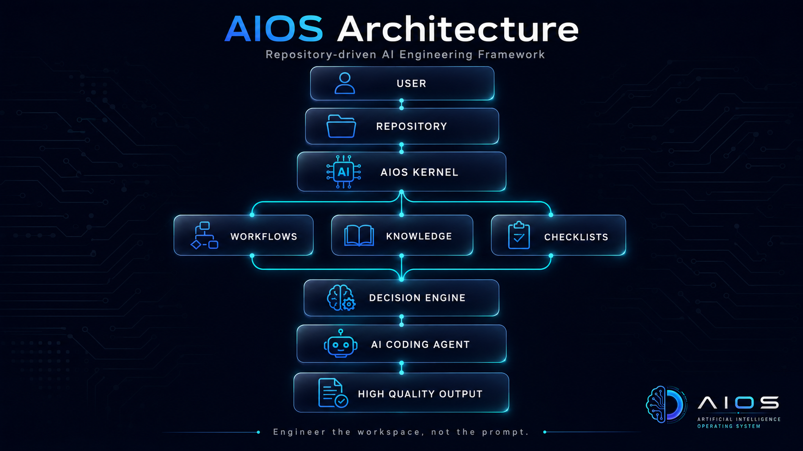
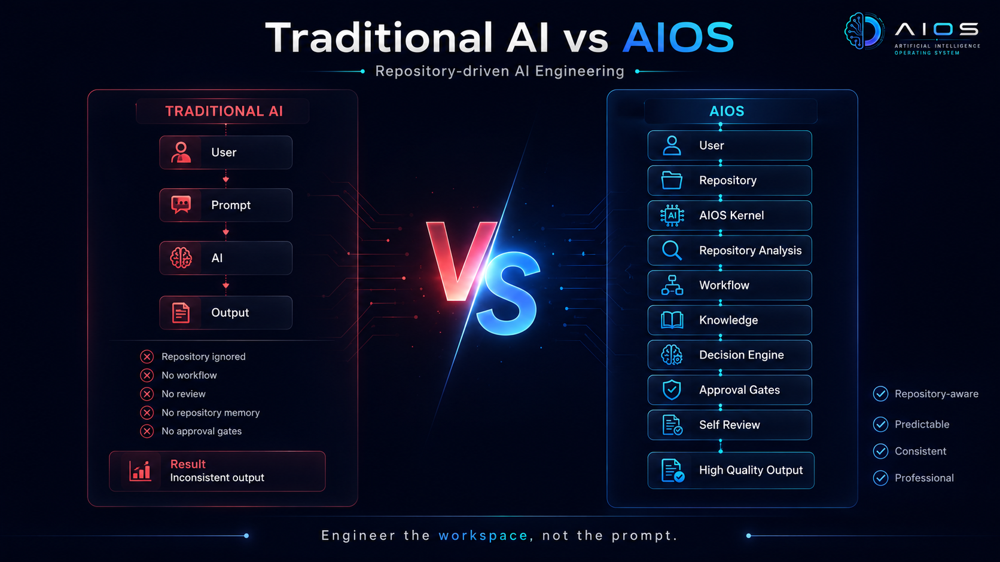
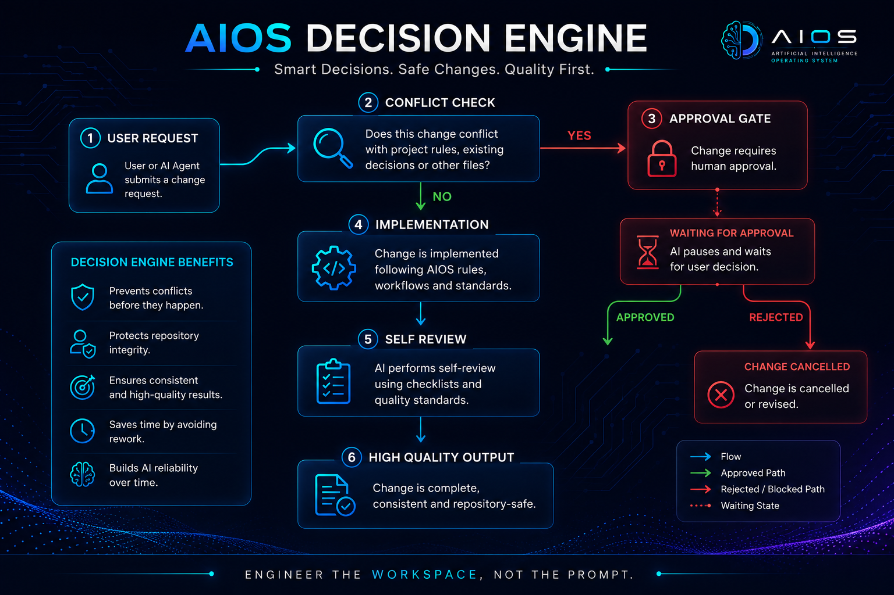
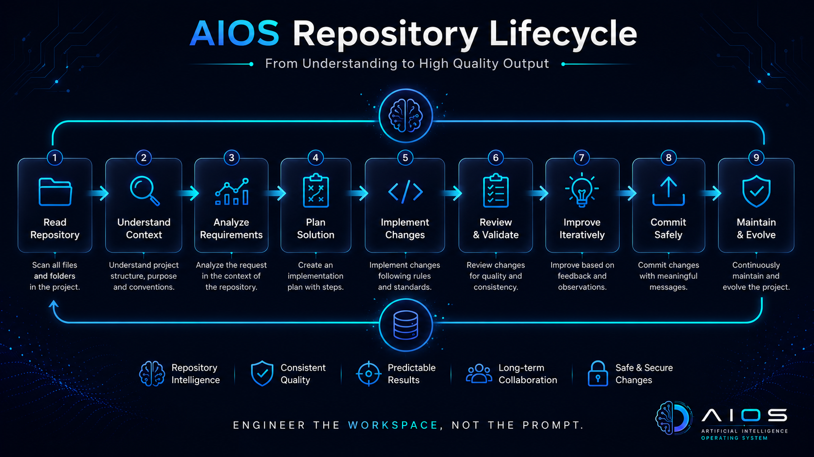

<p align="center">
  
</p>

<p align="center">


[](https://github.com/fdeniz07/AIOS/actions/workflows/ci.yml)


</p>

<p align="center">

**Repository-driven AI Engineering Framework**

*Engineer the workspace, not the prompt.*

</p>

---

# AIOS

AIOS (**Artificial Intelligence Operating System**) is an open-source framework that helps AI coding assistants behave like **repository-aware engineering partners**.

Instead of relying only on chat prompts, AIOS keeps durable engineering context in the repository: operating rules, methodologies, workflows, prompts and structure.

> AIOS provides the **framework**, not the **content**.
>
> Your product knowledge, ADRs, backlogs and curricula stay in your repositories (or in optional packs).

---

## Table of Contents

- Why AIOS
- Philosophy
- Architecture
- Repository Structure
- Governance and Ownership
- How to Consume AIOS
- Capability Status
- Core Components
- AIOS Workflow
- Decision Guidance
- Repository Lifecycle
- Compatible With
- Quick Start
- Tooling Notes (`aiosctl`)
- Validation
- Roadmap
- Contributing
- License
- Vision

---

# Why AIOS?

Modern AI coding assistants are powerful, yet they often:

- ignore repository conventions
- forget previous project decisions
- create inconsistent documentation
- modify unrelated files
- skip quality checks
- duplicate existing implementations

The problem is rarely “not enough prompt text”.

The real gap is **missing persistent project context**.

AIOS moves that context into the repository so humans and agents share the same operating contract.

---

# Philosophy

> AI doesn't become better because of longer prompts.
>
> AI becomes better because of better repositories.

AIOS teaches assistants through engineering structure: rules, methods, reviews and explicit approval gates.

---

# Architecture

<p align="center">

</p>

AIOS sits between your repository and your AI coding assistant as a **governance and method layer**. Its architecture separates the shared **Core**, reusable **Modules**, optional domain **Packs**, and the **Consumer** repository that owns its product and local decisions.

Before rushing to code, assistants are expected to:

- understand
- analyze
- plan
- implement
- review
- document

Detailed layout and directory status: [`PROJECT_STRUCTURE.md`](PROJECT_STRUCTURE.md)

Product manifest: [`MANIFEST.md`](MANIFEST.md)

Authoritative framework contract: [`docs/FRAMEWORK_CONTRACT.md`](docs/FRAMEWORK_CONTRACT.md)

Agent operating manual (operationalizes the contract): [`AGENTS.md`](AGENTS.md)

The Core supplies shared operating guidance, methods, documentation and lightweight tooling. Modules package reusable engineering capabilities; current catalog packages are drafts, not installed or mandatory features. Packs provide optional domain guidance. Consumer repositories retain ownership of product requirements, implementation, ADRs and local policies. This framework does not install, resolve, adopt or execute Modules or Packs for consumers.

### Adaptive Project Intelligence (Phase 6 — completed design)

Phase 6 delivers a **conceptual and documentation foundation** for how agents assess project/task context, scale process depth, recommend guidance, and respect existing governance. It does **not** ship an adaptive runtime, recommendation engine, registry, resolver, scoring system, or automation.

| Document | Role |
|----------|------|
| [`docs/ADAPTIVE_PROJECT_CONTEXT.md`](docs/ADAPTIVE_PROJECT_CONTEXT.md) | Project Context and Task Context models |
| [`docs/PROCESS_DEPTH_MODEL.md`](docs/PROCESS_DEPTH_MODEL.md) | Process Depth (intensity) classification |
| [`docs/ADAPTIVE_GUIDANCE_MODEL.md`](docs/ADAPTIVE_GUIDANCE_MODEL.md) | Guidance types, relevance, and lifecycle |
| [`docs/ADAPTIVE_GOVERNANCE_MODEL.md`](docs/ADAPTIVE_GOVERNANCE_MODEL.md) | Interactions with precedence and human approval |
| [`docs/ADAPTIVE_REFERENCE_SCENARIOS.md`](docs/ADAPTIVE_REFERENCE_SCENARIOS.md) | Integrated illustrative validation scenarios |
| [`docs/ADAPTIVE_PROJECT_INTELLIGENCE_AUDIT.md`](docs/ADAPTIVE_PROJECT_INTELLIGENCE_AUDIT.md) | Documentation-level audit record (**PASS WITH FINDINGS**; not runtime verification) |

Phased status: [`ROADMAP.md`](ROADMAP.md) Phase 6.

---

## Repository Structure

```text
AIOS/
├── AGENTS.md                    # Agent operating manual (operationalizes the contract)
├── MANIFEST.md                  # Product scope and navigation
├── PROJECT_STRUCTURE.md         # Actual tree + status labels
├── ROADMAP.md                   # Framework evolution phases
├── docs/FRAMEWORK_CONTRACT.md   # Authoritative architectural contract
├── docs/ADAPTIVE_*.md           # Phase 6 Adaptive Project Intelligence design docs
├── docs/integrations/           # Coding-assistant integration guides
├── rules/                       # Syncable governance rules (aiosctl sync source)
├── methodology/                 # RDIV, Architecture First, …
├── prompts/                     # Reusable prompts (discovery active; others partial)
├── packs/education/             # Optional education pack (partial)
├── templates/                   # Placeholders for reusable templates
├── checklists/                  # Core checklists
├── modules/                     # Six draft / experimental Engineering Modules
├── validation/                  # Shared foundation and read-only validators
├── workflows/                   # Core workflow definitions
├── scripts/aiosctl.py           # Consumer-facing CLI (sync, version, doctor)
├── assets/                      # Branding and diagrams
├── lab/aios-demo-api/           # Demo app for CI smoke tests
├── knowledge/                   # Planned; currently empty
├── skills/                      # Initial Core skill and conventions
├── tests/                       # CLI tests, validation suites; demo API tests under lab/
└── examples/                    # Documentation-only adoption examples
    ├── 01-core-adoption/        # Core Adoption example
    └── 02-module-guided-adoption/  # Module-Guided Adoption example
```

Directory status varies; see [`PROJECT_STRUCTURE.md`](PROJECT_STRUCTURE.md). Validation is read-only and reports findings; it does not repair or modify the repository.

---

# Governance and Ownership

[`docs/FRAMEWORK_CONTRACT.md`](docs/FRAMEWORK_CONTRACT.md) is the **authoritative architectural meta-document** for AIOS boundaries, consumption models, ownership and instruction precedence.

[`AGENTS.md`](AGENTS.md) **operationalizes** that contract for AI coding agents. It is not a competing authority layer.

### Consumer ownership

- Consumer-approved ADRs and product decisions take precedence over generic AIOS defaults.
- Consumer local policies remain consumer-owned.
- AIOS must not silently overwrite consumer decisions or artifacts.
- Applicable safety, legal, security, privacy, licensing and compliance constraints remain non-overridable.

### Instruction precedence (summary)

AIOS uses a canonical **L0–L7** precedence model (non-overridable constraints → user task instructions → consumer ADRs → consumer local policies → AIOS Core → adopted Packs → Module/methodology recommendations → external knowledge).

Full definition: [`docs/FRAMEWORK_CONTRACT.md`](docs/FRAMEWORK_CONTRACT.md) §7 and [`AGENTS.md`](AGENTS.md) §2.

### Adaptive module recommendations

AIOS is designed to analyze project context and **recommend** relevant engineering Modules.

- The project owner retains decision authority.
- Module guidance is L6 advice by default; if a Consumer explicitly adopts it as local policy, that policy is Consumer-owned at L3.
- Pack guidance is L5 only within a Consumer's explicitly adopted Pack scope.
- Phase 6 documents the Adaptive Project Intelligence **design** (context, process depth, guidance, governance, scenarios, documentation audit).
- This repository does **not** ship an autonomous module-selection or adaptive recommendation **engine** today.

---

# How to Consume AIOS

| Model | Meaning |
|-------|---------|
| **Reference-only** | Read AIOS guidance in place; do not copy AIOS-managed files into the consumer |
| **Synced** | Copy AIOS-managed artifacts under the sync contract (`rules/*.md` → `.agents/` today) |
| **Hybrid** | Combination of reference-only and synced — not a separate runtime |

Synced `.agents/` files are AIOS-derived guidance. Sync does not make AIOS the owner of consumer ADRs or product decisions.

Details: [`docs/FRAMEWORK_CONTRACT.md`](docs/FRAMEWORK_CONTRACT.md) §8–§9.

---

# Capability Status

### Available now

- Framework Contract: `docs/FRAMEWORK_CONTRACT.md`
- Generic `AGENTS.md` operating manual (L0–L7 operationalized)
- Governance rules under `rules/`
- Engineering methodologies under `methodology/`
- Discovery prompt skeletons under `prompts/discovery/`
- Generic architecture review prompt
- `aiosctl` Consumer-facing CLI (`scripts/aiosctl.py`): `sync`, `version`, `doctor`
- `aiosctl sync` copies `rules/*.md` → consumer `.agents/` (compatibility contract)
- Documentation-only adoption examples under `examples/` (Core Adoption; Module-Guided Adoption)
- Coding-assistant integration guides under `docs/integrations/`
- OSS docs: license, contributing, security, code of conduct
- Optional preserved education manual: `packs/education/AGENTS.education.md`
- Six Engineering Module packages in `modules/`, each draft / experimental (not automatically adopted)
- Read-only repository validation entry point: `python -m validation` (independent of `aiosctl`; Framework Structure, Module Contract, and Documentation Integrity validators)
- Shared Validation Foundation with deterministic findings, aggregation, orchestration, reporting and exit codes
- Adaptive Project Intelligence **design documentation** (Phase 6 completed):
  - `docs/ADAPTIVE_PROJECT_CONTEXT.md`
  - `docs/PROCESS_DEPTH_MODEL.md`
  - `docs/ADAPTIVE_GUIDANCE_MODEL.md`
  - `docs/ADAPTIVE_GOVERNANCE_MODEL.md`
  - `docs/ADAPTIVE_REFERENCE_SCENARIOS.md`
  - `docs/ADAPTIVE_PROJECT_INTELLIGENCE_AUDIT.md` (documentation-level audit only)

### Partially available

- Broader prompt library (many placeholder files)
- Templates and checklists (several empty)
- Optional packs beyond the preserved education AGENTS copy

### Available — Validation CI (Phase 8.5)

GitHub Actions (`.github/workflows/ci.yml`) runs two independent framework validation jobs alongside the existing Demo API and repository-report jobs:

- `framework-validation-tests` — pytest over `tests/cli`, `tests/validation_foundation`, `tests/validation_structure`, `tests/validation_module_contract`, and `tests/validation_documentation`
- `framework-validation-cli` — `python -m validation` from the repository root on a clean checkout

These jobs do not configure branch protection or required checks.

### Planned or deferred

- Additional Skills and Knowledge content
- `aiosctl` commands **`validate`** and **`init`** (not implemented; `python -m validation` is a separate entry point, not an `aiosctl` subcommand)
- Adaptive recommendation **engine** / runtime (separate future approval; not part of Phase 6)

See [`ROADMAP.md`](ROADMAP.md) for phased direction.

---

# Core Components

| Component | Purpose | Status |
|-----------|---------|--------|
| **docs/FRAMEWORK_CONTRACT.md** | Authoritative framework contract | Available |
| **AGENTS.md** | Agent operating manual (operationalizes the contract) | Available |
| **MANIFEST.md** | Product scope and navigation | Available |
| **PROJECT_STRUCTURE.md** | Real layout + status | Available |
| **rules/** | Syncable Core governance guidance | Available |
| **methodology/** | RDIV and related methods | Available |
| **prompts/** | Reusable prompt assets | Partial |
| **packs/** | Optional domain packs (adopted = L5) | Partial |
| **Adaptive Project Intelligence docs** | Context, depth, guidance, governance, scenarios, documentation audit | Available (Phase 6 design; not a runtime) |
| **Modules** | Reusable engineering capabilities | Six draft / experimental packages; no installer or resolver |
| **workflows/** | End-to-end flows | Initial Core workflow definitions available |
| **skills/** | Reusable engineering skills | Initial Core skill available; further catalog planned |
| **knowledge/** | Shared reference knowledge | Planned; currently empty |
| **validation/** | Read-only framework, Module contract, and documentation checks | Foundation and three validators implemented through Phase 8.4 |
| **tests/** | Automated checks | Validation foundation, structure, Module contract, and documentation integrity suites; demo API tests |
| **lab/** | Demo API for CI | Demo only |

---

# AIOS Workflow

<p align="center">

</p>

AIOS recommends **RDIV**:

1. Review
2. Decide
3. Implement
4. Verify

Details: [`methodology/rdiv.md`](methodology/rdiv.md)

This is a **documented method**, not a separate installed runtime engine.

---

# Decision Guidance

<p align="center">

</p>

Before implementing, agents should evaluate:

- repository rules
- existing implementations
- workflow expectations
- approval gates
- quality standards

If a conflict exists, the agent should stop and request human approval instead of making unsafe assumptions.

- **Instruction precedence (what is authoritative):** [`AGENTS.md`](AGENTS.md) §2 / Framework Contract §7
- **Decision quality (which valid option is better):** [`rules/DECISION_RULES.md`](rules/DECISION_RULES.md)
- **Agent modes (behavior profiles, not document authority):** [`rules/AGENT_RULES.md`](rules/AGENT_RULES.md)

There is no separate automated “decision engine” binary in this repository today.

---

# Repository Lifecycle

<p align="center">

</p>

1. Read the repository
2. Understand the project
3. Analyze the request
4. Create a plan
5. Implement changes
6. Review the result
7. Improve iteratively
8. Commit safely
9. Continuously evolve the repository

---

# Design Principles

- Repository-Driven Engineering
- Architecture First
- Model-Agnostic AI
- Explicit Governance
- Human-in-the-Loop Decisions
- Adaptive to Project Context (recommend; do not impose)
- Consumer Ownership of ADRs and Product Decisions
- Framework, Not Content

---

# Compatible With

AIOS is **model-agnostic** and is designed to work with modern AI coding assistants, including:

| AI Assistant | Status |
|--------------|--------|
| ChatGPT | Designed for |
| Codex | Designed for |
| Claude Code | Designed for |
| Cursor | Designed for |
| GitHub Copilot | Designed for |
| Windsurf | Designed for |
| Continue.dev | Designed for |
| Roo Code | Designed for |

“Designed for” means governance documents are written to be assistant-neutral.

Consumer-oriented setup notes for Cursor, GitHub Copilot, Claude Code and OpenAI Codex live under [`docs/integrations/`](docs/integrations/README.md). Windsurf is outside the current Phase 9 integration-guide set.

It does **not** claim automated certification of every tool on every release.

---

# Quick Start

## 1. Clone AIOS

```bash
git clone https://github.com/fdeniz07/AIOS.git
cd AIOS
```

## 2. Adopt the Core framework

At minimum, copy or reference:

- `docs/FRAMEWORK_CONTRACT.md`
- `AGENTS.md`
- `MANIFEST.md`
- `PROJECT_STRUCTURE.md`
- `rules/`
- `methodology/`

Optional:

- `prompts/discovery/`
- `packs/education/` when building education-oriented repositories (Pack guidance applies only when adopted)

## 3. Open your consumer repository in your coding assistant

## 4. Initialize the assistant

```text
Read docs/FRAMEWORK_CONTRACT.md and AGENTS.md.
Respect consumer ADRs and local policies over generic AIOS defaults.
Follow L0–L7 instruction precedence.
Understand the repository before making changes.
Recommend Modules adaptively; do not impose them.
Wait for confirmation when standards or durable decisions conflict.
```

## 5. Sync rules into a consumer project (optional)

From the AIOS repository:

```bash
python scripts/aiosctl.py sync --project /path/to/your/project
```

This copies `rules/*.md` into `<project>/.agents/` and writes `AIOS_VERSION.md`.

---

# Tooling Notes (`aiosctl`)

`scripts/aiosctl.py` is the Consumer-facing CLI. It is distinct from `python -m validation`, which is an independent read-only repository validation entry point (not an `aiosctl` subcommand).

| Item | Current behavior |
|------|------------------|
| Implemented commands | `sync`, `version`, `doctor` |
| Not implemented | `validate`, `init` |
| `sync` source | `rules/*.md` |
| `sync` destination | `<project>/.agents/` |
| `sync` project selection | Explicit `--project` |
| Skip logic | Content hash (unless `--force`) |
| Orphan cleanup | Not deleted automatically |
| Version marker | Writes `<project>/.agents/AIOS_VERSION.md` |
| `aiosctl.yaml` | May list helper project names; **not read by the CLI today** |

Compatibility with existing consumers depends on keeping the current sync paths and rule filenames stable.

---

# Validation

AIOS provides a read-only validation package. Its shared [Validation Foundation](docs/VALIDATION_FOUNDATION.md) defines a common `Finding` / `ValidationResult` model, deterministic aggregation and reporting, and exit codes (`0` = no errors, `1` = validation errors, `2` = execution failure). The explicit [Orchestrator](validation/orchestrator.py) runs registered validators in name order and combines their findings; it is not a plugin loader or dynamic registry.

The implemented validators are:

| Component | Scope |
|-----------|-------|
| **Validation Foundation** (Phase 8.1.2; [design and contract](docs/VALIDATION_FOUNDATION.md)) | Shared findings, aggregation, orchestration, reporter and CLI infrastructure. |
| **Framework Structure Validator** (Phase 8.2; [scope and rules](docs/FRAMEWORK_STRUCTURE_VALIDATION_DESIGN.md)) | Checks required framework paths and their types, root selection and the documented conditional `.github/` path. Optional and reserved paths remain optional. |
| **Module Contract Validator** (Phase 8.3; [scope and rules](docs/MODULE_CONTRACT_VALIDATION_DESIGN.md)) | Discovers immediate Module package candidates and checks filesystem containment, `module.yaml` metadata and documented lifecycle / README requirements. |
| **Documentation Integrity Validator** (Phase 8.4) | Scans repository Markdown for broken local links, target types, repository-boundary escapes, missing anchors and local images. Reports `DOC-001`–`DOC-006`; external URLs are skipped. |

The three domain validators register with the shared Orchestrator and use the same reporter and exit-code contract. Documentation Integrity scans Markdown files recursively, excluding `.git` and without descending directory symlinks; it checks local references and does not fetch external URLs. Validation reports findings only: it does not modify files, repair structure, install or adopt Modules, resolve dependencies, or validate Packs.

Run from the repository root:

```bash
python -m validation
```

The CLI also supports an explicit framework root:

```bash
python -m validation --root /path/to/AIOS
```

The default run registers `documentation-integrity`, `framework-structure`, and `module-contract` (execution order by ascending name); it prints a text report and exits with the shared `0` / `1` / `2` contract. `--root` selects an explicit framework root; `--help` lists the available option. This is repository contract validation, not an AI behavior or IDE conformance suite.

Validation tests are organized under `tests/validation_foundation/`, `tests/validation_structure/`, `tests/validation_module_contract/`, and `tests/validation_documentation/`. With the project test dependencies installed, run them with:

```bash
python -m pytest tests/validation_foundation tests/validation_structure tests/validation_module_contract tests/validation_documentation
```

The demo API's tests are separate under `lab/aios-demo-api/`. GitHub Actions also runs the Demo API smoke tests and repository-report jobs independently of the framework validation jobs `framework-validation-tests` and `framework-validation-cli`. Branch protection and required-check configuration are outside this documentation.

---

# Roadmap

High-level direction (details in [`ROADMAP.md`](ROADMAP.md)):

0. Foundation and identity — **Completed**
1. Framework contract and governance — **Completed**
2. Architecture and Module foundation — **Completed**
3. CLI improvements — `aiosctl` implements `sync`, `version`, and `doctor`; `validate` and `init` remain not implemented (see [`ROADMAP.md`](ROADMAP.md) Phase 3).
4. Workflow and checklist system — **Completed**
5. Skills and Knowledge — **Completed:** the initial Core Skill definition was created and accepted (its artifact lifecycle remains `draft`); the Knowledge library has not been created and remains planned.
6. Adaptive Project Intelligence — **Completed** (conceptual / documentation foundation; not an adaptive engine)
7. Engineering Module catalog / packaging — **Completed** (six draft / experimental packages)
8. Validation and automation — Validation Foundation and Framework Structure, Module Contract, and Documentation Integrity validators are implemented through Phase 8.4; Phase 8.5 adds GitHub Actions jobs `framework-validation-tests` (including `tests/cli`) and `framework-validation-cli`.
9. Ecosystem and integrations — adoption examples and coding-assistant integration guides are present under `examples/` and `docs/integrations/`

Phases are directional, not dated commitments. Completed phases still do not imply unimplemented runtime features.

---

# Contributing

Contributions are welcome — especially reusable workflows, skills, documentation and tests that preserve the framework contract.

Please read [`CONTRIBUTING.md`](CONTRIBUTING.md) and open an Issue before major architectural changes.

---

# License

Released under the MIT License. See [`LICENSE`](LICENSE).

---

# Vision

AIOS is not another prompt dump.

It is not another AI wrapper.

It is not another coding assistant.

AIOS is an engineering framework that helps AI become a reliable long-term software development partner — across stacks, teams and tools.

---

<p align="center">

### Build better repositories.

# Get better AI.

</p>

---

<p align="center">
Made with ❤️ for the AI Engineering community.
</p>
