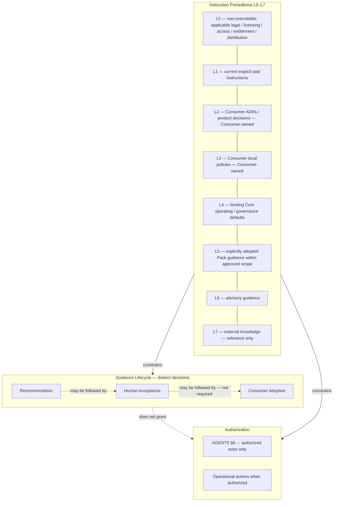
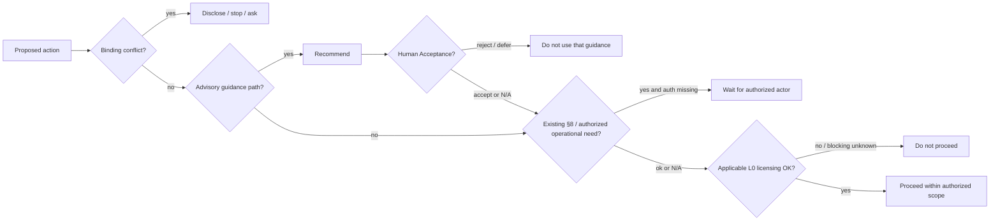

# AIOS Adaptive Governance Model

Version: 0.1.0

Status: Draft

Last Updated: 2026-11-03

Document type: Adaptive Project Intelligence design specification

This document defines the Core **Adaptive Governance Model** for AIOS Adaptive Project Intelligence.

It explains how Adaptive Project Intelligence **interacts** with existing AIOS instruction precedence, guidance lifecycle, and authorization mechanisms.

It is subordinate to the Framework Contract and the agent operating manual:

- Instruction precedence (L0–L7): [`FRAMEWORK_CONTRACT.md`](FRAMEWORK_CONTRACT.md) §7; [`../AGENTS.md`](../AGENTS.md) §2
- Consumer ownership: [`FRAMEWORK_CONTRACT.md`](FRAMEWORK_CONTRACT.md) §5.4
- Adaptive recommendation architecture (unchanged; rewrite deferred): [`FRAMEWORK_CONTRACT.md`](FRAMEWORK_CONTRACT.md) §5.6
- Human Approval Gates: [`../AGENTS.md`](../AGENTS.md) §8
- Project Context and Task Context: [`ADAPTIVE_PROJECT_CONTEXT.md`](ADAPTIVE_PROJECT_CONTEXT.md)
- Process Depth: [`PROCESS_DEPTH_MODEL.md`](PROCESS_DEPTH_MODEL.md)
- Adaptive Guidance (including Guidance Lifecycle semantics): [`ADAPTIVE_GUIDANCE_MODEL.md`](ADAPTIVE_GUIDANCE_MODEL.md)

This document is **conceptual design guidance**. It does **not** implement a governance runtime, approval engine, parser, schema, registry, resolver, scoring system, or automatic approval/adoption mechanism.

**Normative language:** **MUST**, **MUST NOT**, **SHOULD**, and **MAY** are used only when grounded in an existing authoritative rule or an explicitly accepted Product Owner decision for this model. Explanatory clarifications are labeled as such and **MUST NOT** be read as new Human Approval Policies.

---

## 1. Purpose and Scope

### Purpose

Provide a single, coherent reference for how agents and humans should reason about:

1. What an agent **MAY** recommend.
2. What **Human Acceptance** means — and does not mean.
3. What **Consumer Adoption** means — and does not mean.
4. When existing **AGENTS.md §8** Human Approval Gates apply.
5. Which decisions remain exclusively **Consumer-owned**.
6. How **instruction precedence** and **authorization** remain independent concerns.

### In scope

- Governance **interactions** among Adaptive Project Intelligence artifacts and existing Core governance
- Consistent terminology for three independent governance dimensions (see §4)
- Cross-references to authoritative lifecycle, precedence, and approval sources
- Ownership and conflict-handling clarifications that do not invent new gates

### Out of scope

- New Human Approval Policies
- Changes to [`../AGENTS.md`](../AGENTS.md) §8 text or authority
- Rewrite of [`FRAMEWORK_CONTRACT.md`](FRAMEWORK_CONTRACT.md) §5.6 (deferred)
- Acceptance or Adoption **recording schemas** or mandated mechanisms (Consumer-owned)
- Redefinition of L0–L7, Process Depth levels, Guidance Types, or Workflow stage eligibility
- Runtime engines, registries, resolvers, scoring, ML classification, or Adaptive CLI
- Automatic approval, adoption, Module/Pack installation, or Consumer repository modification
- Integrated reference scenarios and documentation-level final audit content (defined in [`ADAPTIVE_REFERENCE_SCENARIOS.md`](ADAPTIVE_REFERENCE_SCENARIOS.md) and [`ADAPTIVE_PROJECT_INTELLIGENCE_AUDIT.md`](ADAPTIVE_PROJECT_INTELLIGENCE_AUDIT.md); this document does **not** redefine them)

---

## 2. Relationship to Existing AIOS Architecture

| Artifact | Owns | This document |
|----------|------|---------------|
| [`FRAMEWORK_CONTRACT.md`](FRAMEWORK_CONTRACT.md) | Architectural boundaries, L0–L7, Module/Pack governance | Applies; does not redefine |
| [`../AGENTS.md`](../AGENTS.md) | Agent operationalization; §8 Human Approval Gates | Applies; does not change §8 |
| [`ADAPTIVE_PROJECT_CONTEXT.md`](ADAPTIVE_PROJECT_CONTEXT.md) | Project Context and Task Context | Context may surface approval needs; does not grant approval |
| [`PROCESS_DEPTH_MODEL.md`](PROCESS_DEPTH_MODEL.md) | Process Depth (**usage intensity**) | Intensity ≠ authorization or guidance selection |
| [`ADAPTIVE_GUIDANCE_MODEL.md`](ADAPTIVE_GUIDANCE_MODEL.md) | Guidance relevance; **canonical Guidance Lifecycle** semantics | Interactions with governance; lifecycle rules remain in AGM |
| Feature Development / Release Workflows | Stage classifications, review vs release vs publication | Distinctions referenced; rules not duplicated |
| This document | Governance **interaction** model | Does not replace the rows above |

**Canonical lifecycle source:** [`ADAPTIVE_GUIDANCE_MODEL.md`](ADAPTIVE_GUIDANCE_MODEL.md) §9 remains authoritative for Recommendation, Human Acceptance, and Consumer Adoption semantics. This document **MUST NOT** redefine those semantics; it explains how they interact with precedence and authorization.

---

## 3. Governance Foundations — L0–L7

Authoritative definitions: [`FRAMEWORK_CONTRACT.md`](FRAMEWORK_CONTRACT.md) §7 and [`../AGENTS.md`](../AGENTS.md) §2. This section **applies** them; it **MUST NOT** redefine levels.

| Level | Summary treatment in Adaptive Governance |
|-------|------------------------------------------|
| **L0** | Non-overridable constraints. Where applicable, **legal, licensing, access, entitlement, and distribution** restrictions are **L0** — not a separate governance axis (see §12). |
| **L1** | Explicit current-task instructions (within L0). Do not silently rewrite durable L2/L3. |
| **L2** | Consumer-approved ADRs and product decisions — Consumer-owned. |
| **L3** | **Consumer local policies** — Consumer-owned; binding within scope. |
| **L4** | AIOS Core binding operating and governance defaults. **MUST NOT** be presented as ordinary optional recommendations ([`ADAPTIVE_GUIDANCE_MODEL.md`](ADAPTIVE_GUIDANCE_MODEL.md)). |
| **L5** | **Explicitly adopted Pack** guidance within approved Pack scope. |
| **L6** | Advisory recommendations: **Core advisory guidance** (including Workflow, Checklist, Skill, Methodology); L6 Module recommendations; L6 recommendations for Packs not yet adopted ([`ADAPTIVE_GUIDANCE_MODEL.md`](ADAPTIVE_GUIDANCE_MODEL.md) §9.2). |
| **L7** | External knowledge — reference only. |

### Module adoption and L3 (clarification)

- **Consumer local policies** remain **L3**.
- **Explicitly adopted Pack guidance** remains **L5** within its approved scope.
- **Module adoption does not automatically elevate all Module content to L3.**
- Whether and how adopted Module guidance becomes binding Consumer local policy remains a **Consumer-owned** decision under existing Module governance ([`FRAMEWORK_CONTRACT.md`](FRAMEWORK_CONTRACT.md) §5.2; [`ADAPTIVE_GUIDANCE_MODEL.md`](ADAPTIVE_GUIDANCE_MODEL.md)). This document does **not** invent a new precedence class for Modules.
- Pack adoption **MUST NOT** implicitly adopt constituent Modules ([`ADAPTIVE_GUIDANCE_MODEL.md`](ADAPTIVE_GUIDANCE_MODEL.md) §10).

### Guidance Types (reminder)

Exactly six canonical Guidance Types are defined in [`ADAPTIVE_GUIDANCE_MODEL.md`](ADAPTIVE_GUIDANCE_MODEL.md) §4: Workflow, Checklist, Skill, Methodology, Module, Pack.

**Prompt** and **Knowledge** remain **supporting resources**, not independent Guidance Types ([`ADAPTIVE_GUIDANCE_MODEL.md`](ADAPTIVE_GUIDANCE_MODEL.md) §5).

### Core origin

Presence of an artifact in Core **MUST NOT** automatically elevate L6 advisory guidance to L4 ([`ADAPTIVE_GUIDANCE_MODEL.md`](ADAPTIVE_GUIDANCE_MODEL.md)).

---

## 4. Three Independent Governance Dimensions

Use this terminology consistently:

| Dimension | Question answered | Primary authority |
|-----------|-------------------|-------------------|
| **Instruction Precedence (L0–L7)** | Which instruction wins when guidance conflicts? | [`FRAMEWORK_CONTRACT.md`](FRAMEWORK_CONTRACT.md) §7; [`../AGENTS.md`](../AGENTS.md) §2 |
| **Guidance Lifecycle** | Was guidance recommended, accepted for this task, and/or adopted by the Consumer? | [`ADAPTIVE_GUIDANCE_MODEL.md`](ADAPTIVE_GUIDANCE_MODEL.md) §9 |
| **Authorization** | May a specific operation or durable change proceed under existing §8 / Consumer authority? | [`../AGENTS.md`](../AGENTS.md) §8; Consumer-authorized roles |

These dimensions are **independent**:

- Completing a Guidance Lifecycle step **MUST NOT** be treated as Instruction Precedence change or as Authorization.
- Satisfying Authorization **MUST NOT** be treated as Consumer Adoption or as Human Acceptance of advisory guidance.
- Applicable licensing and related restrictions remain **within L0** under Instruction Precedence — **not** a fourth governance dimension.

The diagram is explanatory. Dotted edges **MUST NOT** be read as mandatory sequences, new gates, or runtime control flow.

---

## 5. Adaptive Guidance Lifecycle

**Canonical semantics:** [`ADAPTIVE_GUIDANCE_MODEL.md`](ADAPTIVE_GUIDANCE_MODEL.md) §9.

Recommendation, Human Acceptance, and Consumer Adoption are **three distinct decisions**. Consumer Adoption is **not** a mandatory consequence of Human Acceptance.

| Stage | Meaning | Authorizes | MUST NOT authorize |
|-------|---------|------------|-------------------|
| **Recommendation** | Identify and explain potentially relevant **advisory** guidance | Presenting advice only | §8 approval; Adoption; L5; licensing/access rights; Consumer repo modification; downgrading L4 or adopted L5 to optional advice |
| **Human Acceptance** | Decision to **use** recommended advisory guidance for the **current task**, within existing task authorization | Task-level use of that advisory guidance within existing task authorization | Consumer Adoption; L5; durable ADR/policy changes; commit, push, publish, deploy; any §8-listed operation; licensing/access rights; blanket authorization |
| **Consumer Adoption** | Explicit Consumer decision to incorporate guidance into repository, policies, or durable practice | Only what the Consumer **explicitly** records under existing rules and approved scope | Automatic §8/operational authorization; licensing grants; implicit Module adoption via Pack; automatic elevation of all Module content to L3 |

**Recording:** Formats and mechanisms for Acceptance or Adoption records remain **Consumer-owned**. This document **MUST NOT** introduce a Core recording schema.

Human Acceptance **MUST NOT** apply as a recurring Accept/Reject mechanism to binding L4 rules or already adopted L5 Pack guidance within scope ([`ADAPTIVE_GUIDANCE_MODEL.md`](ADAPTIVE_GUIDANCE_MODEL.md) §9.2).

---

## 6. Human Approval Gates — AGENTS.md §8

[`../AGENTS.md`](../AGENTS.md) §8 remains **authoritative and unchanged** by this document.

§8 covers conflict disclosure before overriding ordinary standards and lists operations that require explicit approval (for example significant deletion/rename, repository-wide restructuring, large multi-component refactors, public contract or data breaks, new top-level architecture conventions, irreversible destruction risk, and changing durable Consumer ADRs/product decisions). L0 constraints cannot be approved away.

### Independence

AGENTS.md §8 requirements apply **independently** of:

- Process Depth ([`PROCESS_DEPTH_MODEL.md`](PROCESS_DEPTH_MODEL.md))
- Human Acceptance
- Consumer Adoption
- Feature Development or Release Workflow stage completion
- Checklist completion
- Release go / no-go / defer decisions

Guidance Lifecycle stages **MUST NOT** bypass §8. When in doubt, ask ([`../AGENTS.md`](../AGENTS.md) §8).

This document does **not** add, remove, or reclassify §8 operations.

---

## 7. Authorization and Operational Boundaries

### Human Acceptance versus §8 authorization

| Concept | Meaning |
|---------|---------|
| **Human Acceptance** | Decision to use **advisory guidance** for the **current task**, within existing task authorization ([`ADAPTIVE_GUIDANCE_MODEL.md`](ADAPTIVE_GUIDANCE_MODEL.md) §9.2) |
| **§8 Authorization** | Permission for a §8-listed or otherwise §8-required action, granted **only** by an actor authorized under [`../AGENTS.md`](../AGENTS.md) §8 and applicable Consumer authority |

A person who **MAY** perform Human Acceptance for advisory guidance is **not** automatically authorized to approve an operation under §8.

Only an actor authorized under existing AGENTS.md §8 / Consumer authority **MAY** grant the relevant authorization. A reviewer or operator does **not** automatically hold that authority by title alone.

**AIOS Product Owner** (framework authority) and **Consumer Product Owner** / Consumer authorized owner (product and Consumer-repository authority) remain distinct. This document does **not** introduce new authority roles or policies.

### Consumer Adoption versus implementation authorization

**Consumer Adoption** defines the **explicitly approved adoption scope** (for example adopted Pack scope at L5, or Consumer-owned local policy decisions).

Consumer Adoption does **not** automatically authorize:

- Code modifications
- Module installation
- Repository changes
- Publication
- Commit, push, deployment, or other operational actions

Existing authorization requirements — including AGENTS.md §8 and Consumer-defined operational processes — continue to apply **independently**.

### Process Depth

Process Depth determines **usage intensity** only ([`PROCESS_DEPTH_MODEL.md`](PROCESS_DEPTH_MODEL.md)). It **MUST NOT** be treated as authorization, guidance-type selection, or Workflow eligibility override.

---

## 8. Workflow and Release Interactions

Existing Workflow rules remain authoritative. This section states distinctions only; it does **not** rewrite stage classifications.

| Concept | Meaning | MUST NOT be confused with |
|---------|---------|---------------------------|
| Technical / checklist review | Verification that a change was reviewed (for example Feature Development Stage 8 and checklist `review`) | Human Acceptance of advisory guidance; §8 operational approval; Release Approval |
| Feature Development Workflow completion | Process run closed under that Workflow | Publication rights; §8 authorization; Consumer Adoption |
| Human Acceptance (AGM) | Task-level use of advisory guidance | Workflow completion; §8; Adoption |
| Release Approval | Human go / no-go / defer for a release (Release Workflow Stage 7) | Publication operations; Human Acceptance; Adoption |
| Publication / operational authorization | Explicit prior authorization for tag, push, publish, deploy, or equivalent (Release Workflow Stage 8) | Release Approval alone; checklist completion; Acceptance; Adoption |
| Consumer Adoption | Durable Consumer scope decision | Any of the above authorizations |

References:

- [`../workflows/feature_development.md`](../workflows/feature_development.md) Stage 8
- [`../workflows/release.md`](../workflows/release.md) Stages 7–8
- [`../checklists/review.md`](../checklists/review.md), [`../checklists/release_checklist.md`](../checklists/release_checklist.md)

---

## 9. Decision Ownership and Responsibilities

| Concern | AI Agent | Human reviewer / operator | AIOS Product Owner | Consumer / authorized owner |
|---------|----------|---------------------------|--------------------|-----------------------------|
| Assess context, Process Depth, guidance relevance | Perform and explain | Review | Framework design | Constrains via L2/L3 |
| Recommendation (advisory) | Produce explainable recommendation | Evaluate | — | May constrain |
| Human Acceptance | Request when appropriate | **MAY** accept **if** authorized for that task decision | — | Task authority as applicable |
| Consumer Adoption | Suggest only; never assume | Does **not** auto-adopt | — | **Owns** |
| §8 / operational authorization | Surface need; wait | Grant **only if** that person is the authorized actor | Maintains §8 text (unchanged here) | **Authorized owner** grants |
| L2 ADRs / product decisions | Disclose conflicts | Ask; do not silently rewrite | Not the Consumer product owner | **Owns** |
| L3 local policies | Respect | — | — | **Owns** |
| Acceptance / Adoption records | MAY remind that records are Consumer-owned | — | — | **Owns formats and mechanisms** |
| Implementation / publish / deploy | MUST NOT assume authority | Execute only when authorized | — | Owns process and authorization |
| Licensing / access rights | MUST NOT grant | — | — | Must comply with applicable L0 constraints |

---

## 10. Conflict and Boundary Handling

This document does **not** invent resolution authority. When conflict is decision-critical, stop and ask the authorized owner under existing rules.

| Situation | Required handling |
|-----------|-------------------|
| Advisory guidance conflicts with Consumer L2/L3 | Binding Consumer instructions prevail within scope; disclose; do not impose L6 |
| Recommendation conflicts with applicable L0–L7 binding instruction | Recommendations **MUST NOT** silently override binding instructions ([`../AGENTS.md`](../AGENTS.md) §2) |
| Human Acceptance given but §8 authorization still missing | Do **not** proceed with the §8-listed operation; obtain authorization from an **authorized** actor |
| Pack accepted for task-level use but not adopted | Task-level L6 use only; **no L5** ([`ADAPTIVE_GUIDANCE_MODEL.md`](ADAPTIVE_GUIDANCE_MODEL.md) §10) |
| Pack adopted but constituent Module not explicitly adopted | No implicit Module adoption; Module rules remain separate |
| Licensing, access, entitlement, or distribution rights missing | Treat applicable restrictions as **L0**; lifecycle stages **MUST NOT** grant those rights |
| Task requires a durable Consumer decision | Pursue Consumer Adoption / ADR / local policy path; Human Acceptance is insufficient |
| “Module adopted” without Consumer local policy decision | Do **not** treat all Module content as automatically L3 |

Urgency **MUST NOT** waive L0 constraints or AGENTS.md §8 gates ([`ADAPTIVE_PROJECT_CONTEXT.md`](ADAPTIVE_PROJECT_CONTEXT.md); [`PROCESS_DEPTH_MODEL.md`](PROCESS_DEPTH_MODEL.md)).

---

## 11. Explainability and Transparency

When making governance-related recommendations, agents **SHOULD** communicate conceptually (not via a mandatory metadata schema):

- Guidance identity and type (when recommending guidance)
- Authority class (advisory L6 vs binding constraint vs adopted Pack L5 within scope)
- Which **distinct** Guidance Lifecycle decision is in play (recommend / request Acceptance / suggest Adoption)
- Relevance rationale and supporting evidence or explicit unknowns
- Process Depth / usage intensity when assessed
- What Human Acceptance would and would **not** authorize
- Whether existing §8 may apply, and that only an **authorized** actor may grant §8 authorization
- Whether durable Consumer Adoption is a **separate** Consumer decision
- Applicable licensing/access unknowns
- Conflicts with L2/L3/L4/L5, with paths when known

Agents **MUST NOT** invent missing facts, present assumptions as verified, or claim automatic approval, adoption, or license grants.

### Combined Gate Check (explanatory reasoning aid only)

Agents **MAY** use the following as a **non-normative reasoning aid** when thinking through a proposed action:

1. Is there a binding Instruction Precedence conflict?
2. Is an advisory Guidance Lifecycle path involved (recommend / Acceptance)?
3. Does **existing** AGENTS.md §8 (or Consumer-authorized operational process) require approval from an **authorized** actor?
4. Are applicable L0 licensing/access constraints satisfied or explicitly unknown?

**Critical disclaimer:** The Combined Gate Check is **only** an explanatory reasoning aid. It is **not** a new mandatory approval procedure, Human Approval Policy, gate, Workflow stage, checklist, or runtime mechanism. [`../AGENTS.md`](../AGENTS.md) §8 remains the **sole** authority for its defined approval requirements. Completing one reasoning step does **not** satisfy another dimension.

---

## 12. Licensing and Access Constraints

Aligned with [`ADAPTIVE_GUIDANCE_MODEL.md`](ADAPTIVE_GUIDANCE_MODEL.md) §9.5:

Keep distinct:

| Concern | Role |
|---------|------|
| Guidance Lifecycle decisions | Recommendation, Human Acceptance, Consumer Adoption |
| Instruction Precedence | L0–L7, including applicable legal/licensing constraints at **L0** |
| Authorization | §8 / Consumer-authorized operational permission |

Recommendation, Human Acceptance, and Consumer Adoption **MUST NOT** grant licensing, access, purchase, entitlement, or distribution rights.

Consumer Adoption **MUST NOT** override applicable licensing terms, third-party usage conditions, access restrictions, or distribution requirements.

Pack or Module Adoption **MUST NOT** automatically establish a right to install, redistribute, sublicense, or commercially use included content.

Independence of lifecycle stages from license **grants** **MUST NOT** be read as placing applicable licensing or legal constraints outside the L0–L7 model. Where applicable, those restrictions remain authoritative under **L0**.

---

## 13. Non-goals, Deferred Topics and References

### Non-goals

This document does **not** establish or claim:

- New Human Approval Policies
- AGENTS.md §8 redesign or amendment
- Framework Contract §5.6 rewrite
- Acceptance/Adoption recording schemas or mandated Core mechanisms
- Runtime governance / approval engine
- Automatic approval or adoption
- Registry, resolver, numerical scoring, or ML classification
- Automatic Consumer repository modification
- Changes to `aiosctl sync`
- Reopening of completed Phases 6.1–6.5 decisions
- Delivery ownership of the Phase 6.6 scenario suite or audit specification (those artifacts live in their own documents)

### Deferred

- Evaluation of clarifying [`FRAMEWORK_CONTRACT.md`](FRAMEWORK_CONTRACT.md) §5.6 for all Guidance Types and Acceptance versus Adoption wording (separate Product Owner decision; **remains deferred**)

### Delivered Phase 6.6 artifacts (not defined here)

- Integrated reference scenarios: [`ADAPTIVE_REFERENCE_SCENARIOS.md`](ADAPTIVE_REFERENCE_SCENARIOS.md) (Phase 6.6.3; illustrative validation references; not policies)
- Documentation-level final audit specification: [`ADAPTIVE_PROJECT_INTELLIGENCE_AUDIT.md`](ADAPTIVE_PROJECT_INTELLIGENCE_AUDIT.md) (Phase 6.6.3; not runtime verification)
- Phase **6.6.4** documentation alignment and Phase 6 closure remain **In Progress** on [`../ROADMAP.md`](../ROADMAP.md) until Product Owner acceptance

### Discoverability alignment

- **Completed (Phase 6.5 canonical alignment for this document):** Discoverability updates in `ROADMAP.md`, `PROJECT_STRUCTURE.md`, Framework Contract Related entry points, [`ADAPTIVE_PROJECT_CONTEXT.md`](ADAPTIVE_PROJECT_CONTEXT.md), and [`ADAPTIVE_GUIDANCE_MODEL.md`](ADAPTIVE_GUIDANCE_MODEL.md).
- **In Progress (Phase 6.6.4):** Discoverability updates for [`ADAPTIVE_REFERENCE_SCENARIOS.md`](ADAPTIVE_REFERENCE_SCENARIOS.md) and [`ADAPTIVE_PROJECT_INTELLIGENCE_AUDIT.md`](ADAPTIVE_PROJECT_INTELLIGENCE_AUDIT.md) across ROADMAP, PROJECT_STRUCTURE, Framework Contract Related entry points, APC, PDM, AGM, and this document.
- **Out of Phase 6.6 scope:** An optional [`../AGENTS.md`](../AGENTS.md) §13 Related Entry Points reference is **not** authorized in Phase 6.6 (**MUST NOT** change §8).

### Source references

| Document | Relevance |
|----------|-----------|
| [`FRAMEWORK_CONTRACT.md`](FRAMEWORK_CONTRACT.md) §5.2, §5.4, §5.6, §7 | Module/Pack governance; ownership; deferred §5.6; L0–L7 |
| [`../AGENTS.md`](../AGENTS.md) §2, §7, §8 | Precedence operationalization; adaptive posture; Human Approval Gates |
| [`ADAPTIVE_PROJECT_CONTEXT.md`](ADAPTIVE_PROJECT_CONTEXT.md) | Context; approval surfacing; urgency vs gates |
| [`PROCESS_DEPTH_MODEL.md`](PROCESS_DEPTH_MODEL.md) §5–§6 | Intensity; §8 independence from Depth |
| [`ADAPTIVE_GUIDANCE_MODEL.md`](ADAPTIVE_GUIDANCE_MODEL.md) §4–§5, §9–§11 | Types; supporting resources; lifecycle; Pack/Module; licensing |
| [`ADAPTIVE_REFERENCE_SCENARIOS.md`](ADAPTIVE_REFERENCE_SCENARIOS.md) | Integrated validation scenarios (governance interactions exercised; not new rules) |
| [`ADAPTIVE_PROJECT_INTELLIGENCE_AUDIT.md`](ADAPTIVE_PROJECT_INTELLIGENCE_AUDIT.md) | Documentation-level Phase 6 audit criteria |
| [`../workflows/feature_development.md`](../workflows/feature_development.md) | Stage 8 review vs prior §8 |
| [`../workflows/release.md`](../workflows/release.md) | Release Approval vs publication authorization |
| [`../ROADMAP.md`](../ROADMAP.md) Phase 6 | Design-only Adaptive Project Intelligence; Phase **6.5 Completed**; Phase **6.6 In Progress** |

---

## Document maintenance

- This is a Core Adaptive Project Intelligence **design** document (`Draft` v0.1.0).
- Changes **MUST** remain consistent with [`FRAMEWORK_CONTRACT.md`](FRAMEWORK_CONTRACT.md), [`../AGENTS.md`](../AGENTS.md) §8, [`ADAPTIVE_GUIDANCE_MODEL.md`](ADAPTIVE_GUIDANCE_MODEL.md), [`PROCESS_DEPTH_MODEL.md`](PROCESS_DEPTH_MODEL.md), and [`ADAPTIVE_PROJECT_CONTEXT.md`](ADAPTIVE_PROJECT_CONTEXT.md).
- Do not claim runtime or tooling delivery based on this document alone.
- Do not redefine Guidance Lifecycle semantics here; update [`ADAPTIVE_GUIDANCE_MODEL.md`](ADAPTIVE_GUIDANCE_MODEL.md) when lifecycle rules change.
- Do not amend AGENTS.md §8 through this document.

End of Adaptive Governance Model v0.1.0 (`Draft`).
